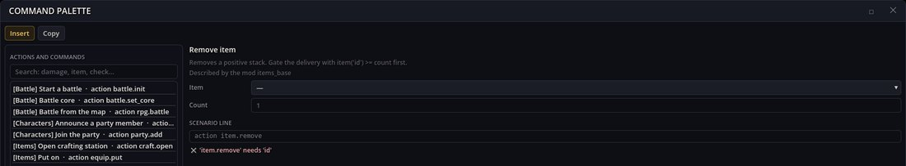
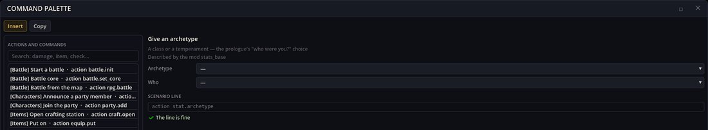
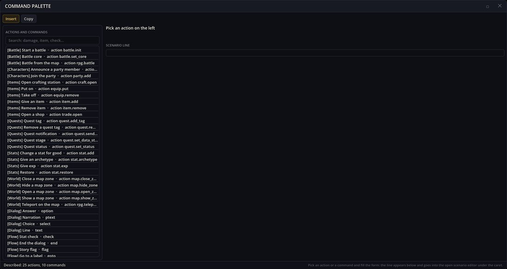

# Schemas — 行動・コマンド・データフィールドの記述

Schemas はライブラリです。どの MOD も、自分のシナリオ行動が何を受け取り、自分の DSL コマンドがどんな形で、自分のデータの種類にどのフィールドがあるのかを、データとして記述できます。ツールはその記述からフォーム、ピッカー、検査を組み立てるので、作者はパラメーター名を覚える代わりにフォームを埋めるだけで済み、誤りはゲームを実行する前に分かります。

この MOD には独自のウィンドウはありません。見える部分は、ほかのツールが表示します:

- **Schema Tools** — コマンドパレットと「データエディター」ウィンドウ；
- **Validator** — 不明・不足のパラメーターと壊れた参照を報告書に載せる；
- **アイテム・キャラクターエディター** — 他の MOD がアイテムやキャラクターに足すフィールド。

## 記述からフォームと検査へ

```text
items_base/schemas/items_base.json        記述。行動のコードのそばに置く
        │
        ▼
スキーマカタログ（全 MOD、読み込み順）
        │
        ├──► コマンドパレットのフォーム      パラメーターごとに一つのフィールド
        ├──► シナリオの行                    action item.remove id=… count=…
        └──► チェッカー                      パレットでもバリデーターでも同じ判定
```

Items Engine は自分の行動 `item.remove` を次のように記述します:

```json
{
  "Id": "item.remove",
  "Name": "items/schema/remove",
  "Description": "items/schema/remove_desc",
  "Category": "items",
  "Params": [
    { "Key": "id", "Type": "ref", "Kind": "item", "Required": true, "Name": "items/schema/field/item" },
    { "Key": "count", "Type": "int", "Default": "1", "Name": "items/schema/field/count" }
  ]
}
```

RPG Plus のコマンドパレットはこれをフォームとして示します: **Item** はゲームのアイテムの一覧（型 `ref`、種類 `item`）、**Count** は 1 が入力済みの数値。アイテムを選ぶまで、チェッカーは何が足りないかを教えます:



Stats Engine の `stat.archetype` には必須パラメーターがないので、同じ空のフォームでも受け付けられます:



読み込まれた MOD が記述した行動とコマンドはすべて、カテゴリーごとにまとまってパレットの一覧に現れます。フッターが数を数えます:



## スキーマファイル

MOD は `schemas/<mod>.json` に、最大三つのリストを同梱します:

- `Actions` — シナリオの行動（`action <id> key=value …`）: そのパラメーター；
- `Commands` — `check` や `select` などの DSL コマンド: 位置パラメーターと名前付きパラメーター；
- `Kinds` — データの種類（`item`、`character`、`shop`…）: そのエンティティのフィールド、新規ファイルのフォルダー、新しい id のパターン。

名前と説明は MOD 自身のローカライズにある翻訳キーなので、フォームはゲームのすべての言語で語ります。

フィールドの型: `text`、`locale`（全言語のテキスト）、`int`、`number`、`bool`、`choice`（`Options` 付き）、`ref` と `ref_list`（種類の id）、`who`、`picture`、`formula`、`condition`、`scene`、`flag`、`label`、`list`（各自のフィールドを持つオブジェクトのリスト）、`values`、`map`、`json`。不明な型はテキストとして編集されます。

## 複数の MOD が一つの種類を記述する

ファイルは MOD の読み込み順に読まれます:

- 行動やコマンドを再度記述すると、後の MOD が**丸ごと置き換えます**；
- 種類は**フィールドごとに統合**されます: 同じキーのフィールドは置き換わり、新しいフィールドは足されます。

たとえば Equipment は、Items Engine の `item` に自分のフィールドを、そのファイルには触れずに足します:

```json
{ "Kind": "item",
  "Fields": [
    { "Key": "Equip", "Type": "text", "Name": "equipment/schema/field/equip" },
    { "Key": "Archetypes", "Type": "ref_list", "Kind": "archetype", "Name": "equipment/schema/field/archetypes" }
  ] }
```

どのフィールドも、どの MOD が記述したかを覚えています（パレットの「MOD items_base が記述」）。壊れたスキーマファイルは報告されて読み飛ばされ、ほかのファイルは引き続き数に入ります。

ルールは、各 MOD が自分の行動・コマンド・種類を、そのコードのそばに記述する、というものです。他の MOD の行動を直すために記述することもでき、その場合は読み込み順が勝ちます。

## チェッカーが報告すること

- **パラメーターが必要** — 必須パラメーターがない（エラー）；
- **パラメーターが存在しない** — 行が、記述にないパラメーターを名指している（警告）；
- **値が不正** — 整数でない、数値でない、選択肢にない（エラー。はい/いいえと選択肢は警告）；
- **不明な参照** — id が、読み込まれたどの MOD も定義しないアイテムやキャラクターなどのエンティティを名指している（エラー）。

バリデーターは同じものを `SCHEMA_MISSING_PARAM`、`SCHEMA_UNKNOWN_PARAM`、`SCHEMA_BAD_VALUE`、`SCHEMA_UNKNOWN_REF` として報告します。チェッカーは記述に書かれたことしか知りません: 受け入れた行でも、ゲームの中では思いがけないことをするかもしれません。

## うまくいかないとき

1. **行動がパレットにない。** 読み込まれたどの MOD も記述していません。それでも行動はシナリオの中で機能します。
2. **フィールドがただのテキストボックスになる。** 型が不明か、フィールドの記述がまったくありません（データエディターはそれを他のフィールドとして JSON で示します）。
3. **フォームがあなたのスキーマを無視する。** 読み込み順で後の MOD が同じ行動を記述し、置き換えました。
